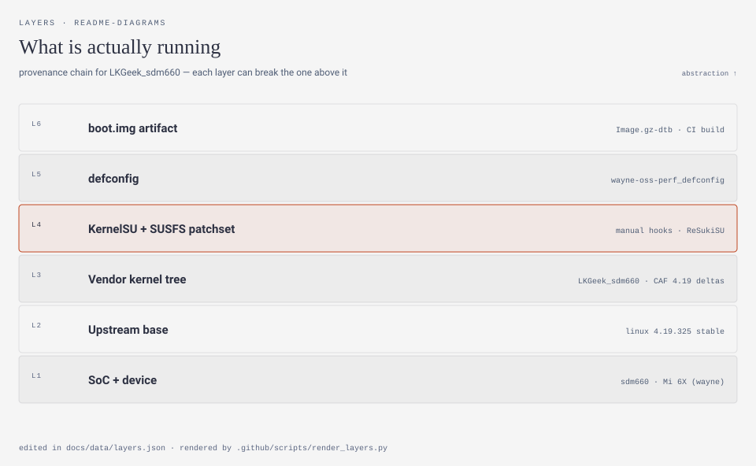
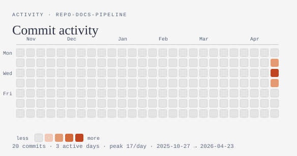
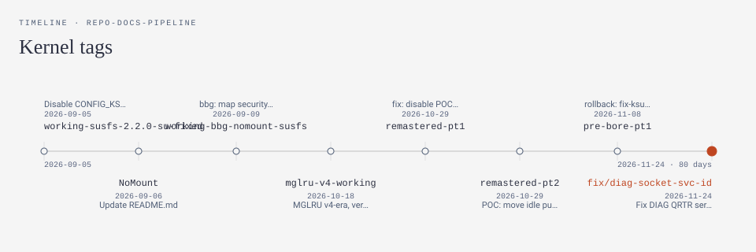

# LKGeek_sdm660 — documentation

This tree is a backport fork: the kernel, the vendor deltas, and the KernelSU/SUSFS
patchset are three different things with three different failure modes. The figures
below are generated from the repo itself by `.github/workflows/docs.yml`; nothing here
is hand-maintained prose about numbers.

## What is actually running

Each layer below can break the one above it. The accent marks the layer that carries
the most risk — the patchset, not the hardware.

<picture>
  <source media="(prefers-color-scheme: dark)" srcset="diagrams/layers-dark.svg">
  
</picture>

Edit `docs/data/layers.json` to change it — a version bump is a one-line diff, not a
redrawn picture.

## Build activity

<picture>
  <source media="(prefers-color-scheme: dark)" srcset="diagrams/activity-dark.svg">
  
</picture>

<picture>
  <source media="(prefers-color-scheme: dark)" srcset="diagrams/timeline-dark.svg">
  
</picture>

## Release notes

`CHANGELOG.md` is generated on every tag push. Because this history is a backport
stream, the generator is configured differently from a feature repo:

- `UPSTREAM:`, `BACKPORT:`, `FROMGIT:` and `[Backport]` subjects collapse into one
  **Upstream intake** section — that is the real signal of what the tree gained.
- `Revert "…"` / `Reapply "…"` pairs are dropped; they cancel out and listing both
  reads as churn.
- Subsystem prefixes (`mm:`, `bpf, sockmap:`, `lib/lz4:`, `KernelSU:`) become scopes
  under **Subsystem changes**, not invented commit types.

Measured on 403 commits of this branch: 191 reverts dropped, 25 upstream intake,
136 subsystem changes, 23 unmapped (reported, never silently lost).
